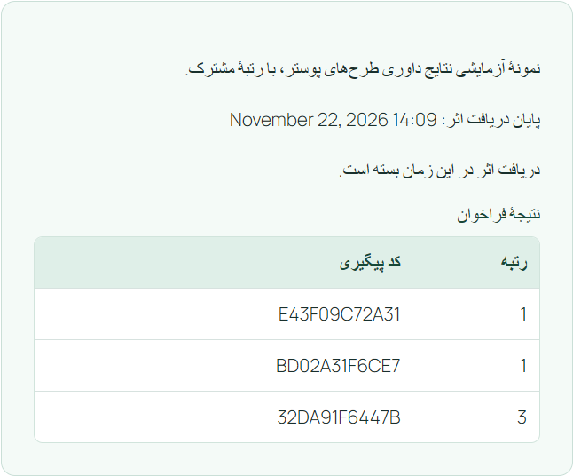

# Chaleshino review workflow

A submission call needs scores from the right judges, reproducible rankings, and an approval step before results go public. This WordPress sample shows the scoring, tie handling, and publication rules from Chaleshino.

The [workflow](src/class-workflow.php) restricts scoring to assigned judges within the judging window. It accepts scores from 0 to 100 with up to two decimal places, including Persian digits. Equal averages share a rank, so the next result after two entries in first place is third. Publication checks for incomplete reviews and compares the current ranking with the reviewed preview before saving a snapshot.

The screenshot shows synthetic receipt codes in the Persian public views of the full plugin.

## Run the integration fixture

Use disposable InnoDB-backed single-site WordPress with <code>WP_ENVIRONMENT_TYPE</code> set to <code>local</code>. Set <code>CODEXAWP_TEST_WP_LOAD</code> to that installation's absolute <code>wp-load.php</code> path.

    CODEXAWP_TEST_WP_LOAD=/path/to/wp-load.php php tests/check.php

The fixture creates a demo call, synthetic entries and test judges. It checks assignment, score validation, ties, stale or incomplete results, permission to publish or revoke, and the public snapshot after revocation and republication. The full product's private file download route is outside this workflow excerpt.

## Source and license

This sample uses selected workflow methods and storage from Chaleshino Call Review 0.1.0. See [NOTICE.txt](NOTICE.txt) for Chaleshino source attribution and [LICENSE.txt](LICENSE.txt) for GPL-2.0-or-later terms.
